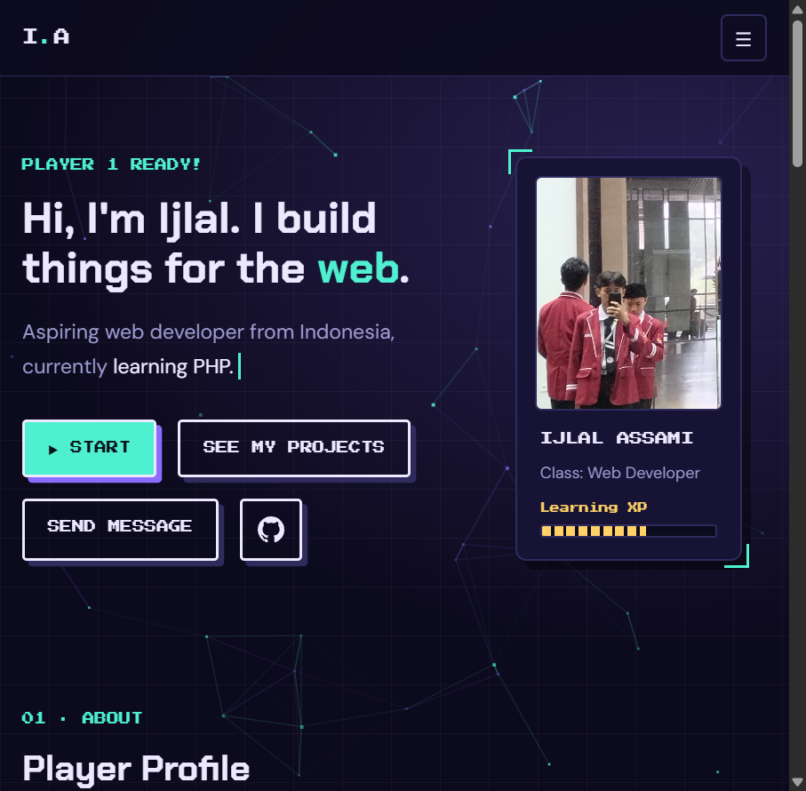

# Ijlal Assami | Portfolio

A game-themed developer portfolio, built from scratch with HTML, CSS, and JavaScript.

**Live site:** https://ijlal-assami.github.io/



## Features

- Game-style loading screen (shown once per browser session)
- Sticky navbar that highlights the current section, with a scroll-progress line
- Typing effect, scroll-reveal animations, and animated XP / skill bars
- Animated background: pixel stars that link up like a skill tree, react to the mouse, and shift as you scroll
- Smooth, inertia-style scrolling
- Four color themes, remembered between visits
- Contact form that sends messages through Formspree without reloading the page
- Achievement-style toast notifications
- A hidden Konami code easter egg
- Responsive layout for phones, tablets, and desktops (including phones with a notch)
- Keyboard-friendly focus ring, and it respects the "reduce motion" setting

## Built with

- **HTML5**: semantic tags and accessible labels
- **CSS3**: custom properties, Grid, Flexbox, and animations
- **Vanilla JavaScript**: no frameworks. The only library is [Lenis](https://github.com/darkroomengineering/lenis) (MIT license) for smooth scrolling
- **Formspree** for the contact form and **GitHub Pages** for hosting

## Project structure

```
ijlal-assami.github.io/
├── index.html
├── css/
│   └── style.css
├── js/
│   ├── lenis.min.js
│   └── main.js
├── images/
│   ├── favicon.svg
│   ├── me.jpg
│   ├── og-image.png
│   └── screenshot.png
└── README.md
```

## Run it locally

```bash
git clone https://github.com/ijlal-assami/ijlal-assami.github.io.git
cd ijlal-assami.github.io
```

Then open `index.html` in your browser, or use the Live Server extension in VS Code.

## What I learned

- Organizing CSS with variables so one change updates the whole site
- Using `IntersectionObserver` for scroll animations and the active menu link
- Sending a form with `fetch` and showing success and error states
- Building for phones first, and for people who prefer less motion
- Using Git with small commits and clear messages

## Author

**Ijlal Assami**, aspiring web developer from Indonesia.
GitHub: [@ijlal-assami](https://github.com/ijlal-assami)
